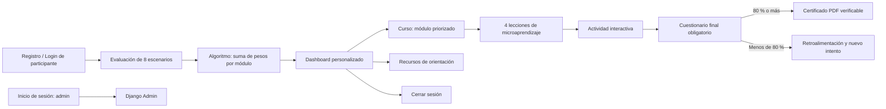

# Mapa de pantallas

El sistema mantiene separados los roles: los participantes registrados y `demo` recorren la experiencia educativa; `admin` solo gestiona el sistema mediante Django Admin. La evaluación es obligatoria antes de mostrar el panel y el curso. Si todas las respuestas son neutrales, se asigna la ruta preventiva de bienestar y seguridad digital. El cuestionario se habilita al completar los cinco microcontenidos y el certificado requiere al menos 80 %.
