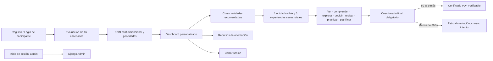

# Mapa de pantallas

El sistema mantiene separados los roles: los participantes registrados y `demo` recorren la experiencia educativa; `admin` solo gestiona el sistema mediante Django Admin. La evaluación es obligatoria antes de mostrar el panel y el curso. Los empates conservan el mismo nivel de prioridad. Si todas las respuestas son neutrales, se asigna la ruta general de Convivencia y Autocuidado Preventivo. El curso muestra una sola unidad y una sola experiencia cada vez; la unidad siguiente requiere el certificado de la anterior. El cuestionario se habilita al completar sus seis experiencias y el certificado requiere al menos 80 %.
