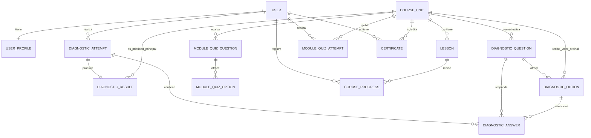

# Modelo de datos inicial

`DiagnosticOption.destination_unit` y `DiagnosticOption.weight` conservan la dimensión y el valor ordinal uniforme de cada alternativa. `DiagnosticResult.profile` guarda la versión del instrumento, las cuatro dimensiones, sus porcentajes, los niveles de prioridad, los empates y todas las unidades recomendadas; `suggested_unit` se mantiene como referencia a la primera unidad para compatibilidad. Cada módulo tiene exploración guiada, decisión, lista interactiva, práctica y plan personal. `CourseProgress.interaction_response` guarda exclusivamente identificadores de opciones o pasos, nunca relatos ni datos personales. El cuestionario final registra intentos y puntuación sin exponer las respuestas correctas. `Certificate` acredita una sola vez la combinación usuario-módulo, almacena un código público único y permite generar el PDF bajo demanda. Se reutiliza el usuario autenticado de Django en lugar de duplicar una tabla de credenciales. `OrientationResource` permanece como catálogo independiente.
