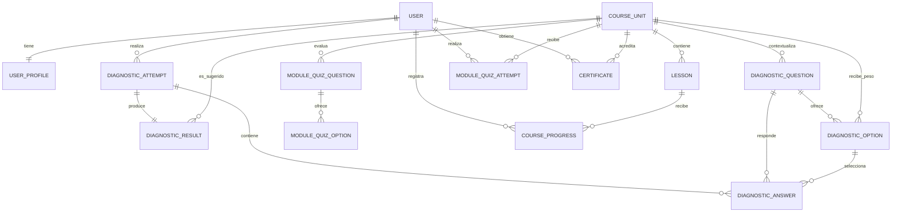

# Modelo de datos inicial

`DiagnosticOption.destination_unit` y `DiagnosticOption.weight` implementan el filtrado. `DiagnosticResult` conserva el módulo sugerido, la puntuación máxima y los totales por módulo. Cada módulo tiene cuatro lecciones y una actividad; `CourseProgress.activity_response` conserva la decisión tomada. El cuestionario final registra intentos y puntuación sin exponer las respuestas correctas. `Certificate` acredita una sola vez la combinación usuario-módulo, almacena un código público único y permite generar el PDF bajo demanda. Se reutiliza el usuario autenticado de Django en lugar de duplicar una tabla de credenciales. `OrientationResource` permanece como catálogo independiente.
